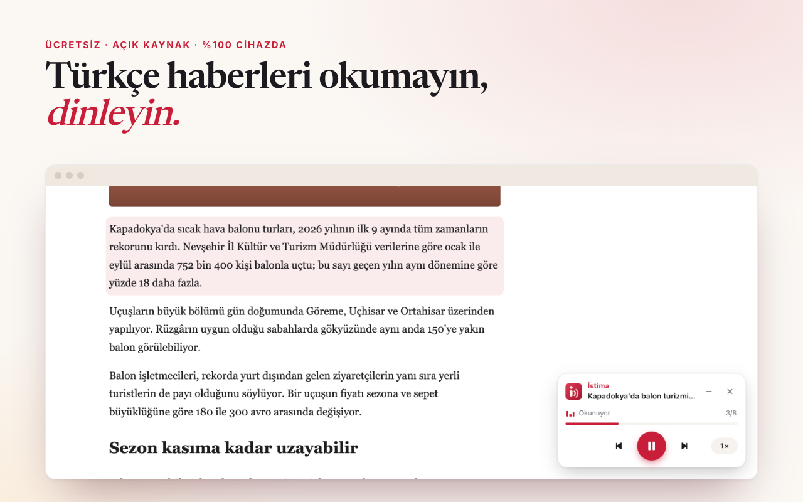

<p align="center">
  
</p>

<h1 align="center">İstima</h1>

<p align="center"><strong>Türkçe haberleri okumayın, dinleyin.</strong><br>
Gezdiğiniz sitelerdeki Türkçe haberleri tek tıkla doğal bir sesle okuyan, yapay zekâ sesi tamamen cihazda çalışan ücretsiz tarayıcı eklentisi.</p>

<p align="center">
  <a href="https://chromewebstore.google.com/detail/idnhjopkmlgdhipcfplknfdfpkcehhle"><strong>Chrome Web Mağazası</strong></a> ·
  <a href="https://istima.ubeydgencer.com">Web sitesi</a> ·
  <a href="https://github.com/ubeydgencer/istima/releases/latest">İndir</a> ·
  <a href="https://istima.ubeydgencer.com/gizlilik/">Gizlilik</a> ·
  <a href="#english">English</a>
</p>

<p align="center"></p>

## Özellikler

- **Tek tıkla dinleme.** Haberde araç çubuğu simgesine, <kbd>Alt</kbd>+<kbd>Shift</kbd>+<kbd>D</kbd>'ye ya da sağ tık menüsüne basın. İsteğe bağlı **“Haberleri otomatik bul”** açıkken her Türkçe haberin köşesinde “Haberi dinle” düğmesi kendiliğinden belirir. Menü, reklam ve yorumlar atlanır.
- **Az izin.** Kurulumda hiçbir siteye erişim istemez (activeTab). Tüm sitelere erişim yalnızca otomatik bulma açılırsa, isteğe bağlı izinle istenir; içerik betiği o zaman `chrome.scripting.registerContentScripts` ile kaydedilir.
- **Her sitede çalışır.** Site listesi yok; haber metni [Mozilla Readability](https://github.com/mozilla/readability) ve Türkçe haber sitelerine göre ayarlanmış filtrelerle ayıklanır. AA, NTV, Hürriyet, Sözcü, Cumhuriyet, Habertürk, Milliyet ve TRT Haber'de denendi.
- **Doğru Türkçe okuma.** Sayılar, tarihler, saatler, para birimleri, kısaltmalar ve metindeki İngilizce kelimeler modelin kendi normalleştiricisiyle okunuşa çevrilir.
- **Okunan yeri gösterir.** Okunan paragraf vurgulanır, sayfa onu takip eder; <kbd>Alt</kbd>+tık ile istediğiniz paragraftan başlar.
- **Hız ve kontrol.** 0,8×–1,75× arası altı hız (ses incelmez, model konuşmayı o hızda üretir), paragraf atlama, ilerleme çubuğundan atlama, sekmeler arası kontrol.
- **Seçili metin.** Sağ tık → “Seçili metni İstima ile dinle”.
- **Kısayollar.** <kbd>Alt</kbd>+<kbd>Shift</kbd>+<kbd>D</kbd> başlat/duraklat, <kbd>Alt</kbd>+<kbd>Shift</kbd>+<kbd>←</kbd>/<kbd>→</kbd> paragraf, <kbd>Alt</kbd>+<kbd>Shift</kbd>+<kbd>X</kbd> durdur.
- **Gizlilik.** Sunucu yok. Metin ve ses cihazdan çıkmaz; analitik, çerez, hesap yok. Seslendirme çevrimdışı çalışır.
- Açık/koyu tema, Türkçe/İngilizce arayüz, Chrome 116+ ve Chromium tabanlı tarayıcılar (Edge, Brave, Opera, Vivaldi, Arc).

## Kurulum

**Chrome Web Mağazası:** [İstima'yı ekle](https://chromewebstore.google.com/detail/idnhjopkmlgdhipcfplknfdfpkcehhle) (Chrome, Edge, Brave, Opera, Vivaldi).

**Zip ile:** [Son sürümü](https://github.com/ubeydgencer/istima/releases/latest) indirip çıkarın, `chrome://extensions` → **Geliştirici modu** → **Paketlenmemiş öğe yükle** ile klasörü seçin. Depoyu klonladıysanız doğrudan `extension/` klasörünü yükleyebilirsiniz.

## Nasıl çalışır

```
 haber sayfası                    eklenti
┌───────────────────┐   paragraflar   ┌────────────────────┐   play/pause/seek   ┌──────────────────────────────┐
│ content script    │ ──────────────► │ background         │ ──────────────────► │ offscreen belge              │
│ Readability +     │                 │ (service worker)   │                     │  Web Worker: Antalia-2 Mini  │
│ filtreler, oynatıcı│ ◄────────────── │ oturum, menüler,   │ ◄────────────────── │  4 ONNX grafiği + iSTFT      │
│ vurgu, Alt+tık    │   durum         │ kısayollar, rozet  │   durum, ilerleme    │  (ONNX Runtime Web, WASM)    │
└───────────────────┘                 └────────────────────┘                     │  Web Audio ile 48 kHz çalma  │
         ▲                                     ▲                                 └──────────────────────────────┘
         └──────────── popup / ayarlar ────────┘
```

1. **İçerik betiği** (`extension/content/`), kullanıcı istediğinde (activeTab) ya da otomatik bulma açıksa her sayfada, sayfanın dilini ve yapısını kontrol eder, Readability ile haberi ayıklar, kategori etiketi, künye, “Google'da takip edin” ve telif notu gibi satırları atar ve her paragrafı sayfadaki öğesiyle eşler.
2. **Arka plan** (`extension/background.js`) okuma oturumunu tutar ve sayfa, popup ve ses belgesi arasında mesajları taşır.
3. **Offscreen belge** (`extension/offscreen/`) modeli bir Web Worker'da çalıştırır, paragrafları oynatmanın 25 saniye önünden üretir ve Web Audio ile çalar. Eklenti sayfaları çapraz köken yalıtımlı olduğu için ONNX Runtime 4 iş parçacığıyla çalışır: model ~1 saniyede hazır olur ve konuşmayı gerçek zamandan çok daha hızlı üretir.
4. **Ses motoru** (`extension/engine/`, `extension/models/`): [Antalia-2 Mini](https://huggingface.co/cloud0day3/antalia-mini), 7,6 M parametreli, 48 kHz çıkışlı Türkçe TTS modeli. ONNX grafikleri, Türkçe normalleştirici ve çıkarım kodu modelin [Hugging Face Space'inden](https://huggingface.co/spaces/cloud0day3/antalia-mini) alındı (fp32 akustik + fp16 vocoder, 22,8 MB).

## Proje yapısı

| Klasör | İçerik |
|---|---|
| `extension/` | Eklentinin kendisi (Manifest V3). Derleme adımı yok; bu klasör olduğu gibi yüklenir. |
| `site/` | [istima.ubeydgencer.com](https://istima.ubeydgencer.com) tanıtım sitesi (statik, Cloudflare Pages) |
| `store/` | Chrome Web Mağazası metinleri ([LISTING.md](store/LISTING.md)) ve görselleri |
| `brand/` | Logo kaynakları |
| `tools/` | Uçtan uca test, ekran görüntüsü, mağaza görseli ve paketleme betikleri |

## Geliştirme

```bash
cd tools
npm install
npm run setup        # Chrome for Testing'i indirir (markalı Chrome --load-extension'ı artık desteklemiyor)
npm test             # eklentiyi gerçek tarayıcıda yükler: tespit, ayıklama, baştan sona okuma, kontroller
npm test -- https://www.ntv.com.tr/...   # ek olarak gerçek haber sayfalarında ayıklamayı dener
npm run screenshots  # arayüz ekran görüntüleri + sitenin görselleri ve örnek sesi (cwebp ve ffmpeg gerekir)
npm run assets       # mağaza görselleri ve OG görseli
npm run package      # dist/istima-<sürüm>.zip
```

Siteyi yayınlamak için:

```bash
node tools/site-version.mjs && npx wrangler pages deploy site --project-name istima
```

## Lisans ve teşekkürler

İstima [Apache-2.0](LICENSE) lisanslıdır. Üçüncü taraf bileşenler ve lisansları [NOTICE](NOTICE) dosyasındadır:

- **Antalia-2 Mini** ses modeli, Türkçe normalleştirici ve tarayıcı çıkarım kodu: PatientDesk AI, Apache-2.0
- **ONNX Runtime Web**: Microsoft, MIT
- **Mozilla Readability**: Apache-2.0
- Site yazı tipleri **Newsreader** ve **Inter**: SIL OFL 1.1

Ses sentetiktir ve gerçek bir kişiye ait değildir. Lütfen dinleyenlere sentetik bir ses duyduklarını belirtin; modeli kimseyi taklit etmek için kullanmayın.

---

## English

**İstima** is a free, open-source Chrome extension that reads Turkish news articles aloud. It finds the article on any site, skips the clutter, highlights the paragraph being read, and speaks with [Antalia-2 Mini](https://huggingface.co/cloud0day3/antalia-mini), a 7.6M-parameter Turkish TTS model that runs **entirely on your device** through ONNX Runtime Web (WebAssembly, 4 threads in a cross-origin-isolated offscreen document). No server, no account, no tracking; speech works offline.

Install from the [Chrome Web Store](https://chromewebstore.google.com/detail/idnhjopkmlgdhipcfplknfdfpkcehhle), or load the [latest release](https://github.com/ubeydgencer/istima/releases/latest) unpacked. See *Geliştirme* above for the test and build scripts. Licensed under Apache-2.0.
